<!-- Las tarjetas son SVG animados generados por scripts/render_cards.py y actualizados a diario
     por .github/workflows/update-profile-cards.yml. Mantén las tarjetas de una misma fila en una
     sola línea y sin espacios entre ellas. -->

 
 
 
 
 

<a href="https://mr-zemoreno.dev/">portafolio</a> &nbsp;/&nbsp; <a href="https://www.linkedin.com/in/josecarlos-vidal/">linkedin</a> &nbsp;/&nbsp; <a href="https://github.com/Mr-ZeMoreno?tab=repositories">repositorios</a>

